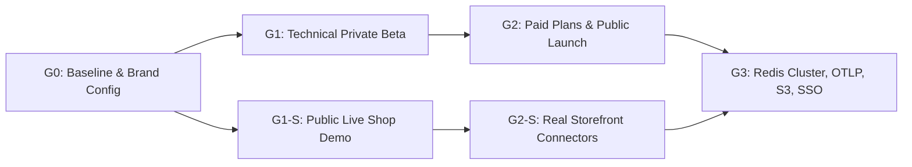

# FlowTrace: Unified SaaS Master Roadmap & Atomic Backlog

> **Источники консолидации:**
> 1. [`docs/SAAS_ROADMAP.md`](./SAAS_ROADMAP.md) (первоначальный план из 9 эпиков)
> 2. [`docs/TASKS.md`](./TASKS.md) (v1 Technical & Commercial SaaS Productization: `E0`..`E15`, `H-01`..`H-10`, `DEC-01`..`DEC-10`)
> 3. [`docs/TASKS_v2.md`](./TASKS_v2.md) (v2 Business Flows / "Live Shop" Extension: `E17`..`E25`, `H-11`..`H-17`, `DEC-11`..`DEC-15`)
>
> **Главный принцип декомпозиции:** Никаких монолитных задач (`L` на 3–5 дней). Каждый эпик разбит на **небольшие логические этапы (атомарные шаги на 1–3 часа работы)**, которые можно реализовать, покрыть тестами и закоммитить за одну итерацию.

---

## Часть 1. Анализ пересечений, дубликатов и уникальных задач

### 1.1. Таблица дедупликации (Что совпало между `SAAS_ROADMAP.md` и `TASKS.md` / `TASKS_v2.md`)

| Тема / Модуль | В `SAAS_ROADMAP.md` | В `TASKS.md` (v1) | В `TASKS_v2.md` (v2) | Статус и решение при слиянии |
|---|---|---|---|---|
| **Организации и членство (БД)** | `TASK-1.1` (Organizations, Members, Workspaces, Invitations) | `E1-01` (Organizations & Memberships migration) | - | **Дубликат (Объединено).** Базовая миграция `V2`, таблицы `organizations`, `workspaces`, `organization_members`, `invitations` **уже реализованы в Сессии #006**. Остался софт-делит (`deleted_at` 30d). |
| **RBAC Ролевая матрица** | `TASK-1.2` (`Owner`, `Admin`, `Member`, `Viewer`, `Billing Admin`) | `E1-02` (`Owner`, `Admin`, `Member`, `Viewer` в application-слое) | - | **Дубликат (Объединено).** Реализовано в `OrgRole` / `OrgPermission` (5 ролей включая `BILLING_ADMIN`). |
| **Приглашения по Email (7d TTL)** | `TASK-1.3` (Токен 7 дней + Email-отправка) | `E1-04` (Invitations by email, 7-day expiry, resend/revoke) | - | **Дубликат (Объединено).** Базовый цикл create/revoke/accept реализован; остаётся шаг `resend` и хеширование `token_hash` в БД. |
| **UI Организации и команды** | `TASK-1.4` (Экран команды, бейджи ролей, свитчер в шапке) | `E1-05` (Org settings page, members, 30-day soft delete) | - | **Дубликат (Объединено).** Экран `Org & Team` и свитчер в шапке реализованы; дополняется 30-дневным soft-delete. |
| **Тарифные планы и лимиты** | `TASK-2.1` (Таблица тарифов Free/Pro/Business/Enterprise) | `E3-02` (`Entitlements` config engine) + `E24-03` (`Shop` plan) | `E24-01`, `E24-03` | **Дубликат с уточнением.** В `TASKS.md` важное правило: **никакого хардкода лимитов в коде** — все планы хранятся в конфиге/БД (`Entitlements`), дефолт — жёсткий лимит (`hard stop`) без внезапных счетов. |
| **Биллинг Checkout, Portal, Webhooks** | `TASK-2.2`, `TASK-2.3` (Stripe Checkout, Portal, Webhooks, Grace period) | `E3-01` (Spike Stripe vs MoR), `E3-03`, `E3-04`, `E3-06` (Dunning 7d) | - | **Дубликат с важным условием.** Сначала выполняется `E3-01` (ADR-сравнение Stripe vs Paddle/Lemon Squeezy для резидента Бельгии/ЕС), затем реализация провайдера. |
| **Счётчики потребления и Quota Guard** | `TASK-2.4` (Usage Metering + Quota 80%/100% + HTTP 429) | `E4-01` (In-memory -> DB flush <=10s), `E4-02`, `E4-03` | `E24-01`, `E24-04` | **Дубликат (Объединено).** В `TASKS.md` более прагматичная архитектура для G1/G2: сначала in-memory атомарный счётчик со сбросом в Postgres каждые `<= 10s` без Redis-зависимости на старте. |
| **Горизонтальное масштабирование (Redis Fanout)** | `TASK-3.1`..`3.4` (`RedisEventFanout`, `RedisTraceStateStore`, Redis Rate Limiter, Multi-task ECS) | `E6-09` (Redis fanout + 2+ Fargate tasks behind NLB/ALB) | - | **Дубликат (Синхронизирован гейт).** В `TASKS.md` зафиксировано правило: **строго Gate G3** (не запускать >1 Fargate-таски до завершения `E6-09`). |
| **OpenTelemetry (OTLP) и SDK (Node, Python, Go)** | `TASK-4.1`..`4.4` (OTLP Receiver, Node SDK, Python SDK, Go SDK) | `E6-10` (OTLP/HTTP), `E7-04` (Node), `E7-05` (Python), `E7-07` (Go) | - | **Дубликат (Объединено).** Дополнено контрактными тестами и `golden vectors` (`E7-06`). |
| **Публичные ссылки и `<iframe>` виджет** | `TASK-4.5` (`/share/{token}` + `<iframe>` embed) | `E6-01` (Share link + watermark), `E6-02` (`<iframe>` + `<flowtrace-embed>`) | Используется в `G1-S` | **Дубликат (Объединено).** Добавлено требование водяного знака на Free-плане и `frame-ancestors` allowlist. |
| **Алертинг и вебхуки** | `TASK-5.1`, `TASK-5.2` (Alert Rules Engine, Slack, Email, Webhooks) | `E6-06` (Alerts: error rate & silence), `E6-07` (HMAC Webhooks) | `E21-03` (Business alerts) | **Дубликат (Объединено).** Единый движок правил для технических (E6) и бизнес-метрик (E21). |
| **Ретеншн по планам и архив в S3 Parquet** | `TASK-6.1`..`6.3` (Партиционирование, S3 Parquet, индексы) | `E4-04` (Retention by plan), `E6-08` (Search p95 < 300ms), `E6-11` (S3 Parquet) | - | **Дубликат (Объединено).** Разделено на быстрый ретеншн по плану (G1) и холодный S3 Parquet архив (G3). |
| **SSO (SAML/OIDC), PII Redaction, Audit Log** | `TASK-7.1`..`7.4` (SAML SSO, SCIM, PII Redaction, Audit Trail) | `E1-06` (Audit log), `E2-08` (SSO), `E4-06` (Payload secret guard) | `E23-01` (Pseudonymization), `E23-02` (PII Guard v2) | **Дубликат (Объединено и расширено).** Audit Log и базовый фильтр секретов идут в G1; полный PII-фильтр (имена/телефоны/адреса) и хеширование `entity.ref` — в G1-S; SAML SSO — в G3. |
| **Мульти-диаграммы, темы, экспорт** | `TASK-8.1`, `TASK-8.4` (Мульти-диаграммы, темы, экспорт SVG/PNG) | `E6-03` (PNG/SVG/WebM/GIF export), `E6-04` (`env` tag + multi-diagram) | `E19-02` (Theme packs), `E19-03` (Zones/Lanes) | **Дубликат (Объединено).** |
| **CI/CD Staging/Prod, Мониторинг, Status Page** | `TASK-9.1`..`9.4` (Envs, Rollback, Dashboards, Status Page) | `E9-05` (Status page), `E10-01/02` (Logs, Dashboards, Alarms), `E12-01..03` | - | **Дубликат (Объединено).** |

---

### 1.2. Что было в `TASKS.md` (v1), но отсутствовало в `SAAS_ROADMAP.md`
1. **Верификация базы (`E0`)**: аудит `spec.md` vs код (`docs/audit/baseline.md`), замер базовой производительности на 500 и 2000 ev/s, вынос имени продукта в единую константу (`DEC-01`, т.к. имя FlowTrace имеет коллизии).
2. **Полноценный жизненный цикл аккаунта (`E2`)**: подтверждение email, сброс пароля, вход через Google/GitHub, скоупы API-ключей (`ingest`, `read`), ротация ключей, GDPR-выгрузка архива данных и удаление аккаунта, Personal Access Tokens (PAT) для CI, опциональный TOTP MFA.
3. **Онбординг и активация (`E5`)**: пошаговый мастер первого запуска с экраном *«Waiting for first event…»* и живым празднованием первого пакета, публичная страница `/demo` без регистрации, чек-лист активации и триггерные письма.
4. **Публичный маркетинговый сайт на Astro (`E8`)**: отдельный статический сайт `/website`, лендинг со встроенным живым демо, страница цен из конфига, форма Waitlist с опросом сегмента, документация Starlight/Docusaurus, честные страницы сравнения с конкурентами (только проверяемые факты со ссылками и датами).
5. **Собственная наблюдаемость и Dogfooding (`E10`)**: синтетический канареечный тест (каждую минуту шлёт событие по HTTP, UDP и TCP в прод и проверяет приход по WS, рисуя сам себя во FlowTrace), SLO/Error Budget, AWS Budgets.
6. **Безопасность и качество (`E11`, `E13`)**: модель угроз STRIDE (`docs/security/threat-model.md`), автотест на отсутствие не-org-scoped SQL-запросов, `security.txt`, HMAC-подпись для UDP-датаграмм, учения по восстановлению БД из бэкапа (PITR drill), регрессионные скриншот-тесты с детерминированным таймером.
7. **Продуктовая аналитика и Админка платформы (`E14`, `E15`)**: таксономия событий воронки (PostHog EU cookieless), дашборд основателя (MRR, Time-to-First-Event), консоль `platform_admin`, фича-флаги и kill-switch по протоколам/организациям, режим безопасного просмотра `view as`.

### 1.3. Что было в `TASKS_v2.md` ("Live Shop / Business Flows"), но отсутствовало в обоих первых документах
1. **Токены-сущности и переносимая корзина (`E17`)**: расширение протокола до v1.1 (`entity` с аватаром клиента + `carry` с товарами и суммой), операции `set/add/remove/clear` в `TraceState`, новые типы событий (`complete`, `fail`, `abandon`, `crowd`), рендерер иконок посетителей с летящими за ними товарами, безопасный прокси картинок с защитой от SSRF и очисткой SVG, таймеры брошенных корзин (`abandon`) и режим толпы (`Crowd mode`).
2. **Движок бизнес-шаблонов и YAML-симулятор сценариев (`E18`)**: декларативные JSON-шаблоны без кода, детерминированный симулятор персон покупателей (`browser`, `buyer`, `hesitant`, `abandoner`) с обязательным бейджем `"DEMO DATA"`, 6 готовых шаблонов (Онлайн-магазин, Ресторан, Доставка еды, Запись/Бронирование, SaaS-воронка, Поддержка).
3. **Визуальная система для бизнеса и ТВ-режим (`E19`, `E22`)**: 80+ лицензионных SVG-иконок, темы *Cozy Light* и *Pastel*, зоны/дорожки на холсте, эффекты монет при оплате, **TV / Kiosk Mode** (полный экран с защитой от выгорания и WakeLock), звуковой пакет (опциональный звон кассы) и мобильный PWA для владельца магазина.
4. **No-code коннекторы и бизнес-метрики (`E20`, `E21`, `E23`–`E25`)**: универсальный вебхук с UI-маппингом JSONPath, браузерный сниппет `flowtrace.js` (`sendBeacon`, без кук и IP), GTM/GA4 адаптер, Stripe коннектор оплаты, полоса живых бизнес-метрик (Посетители сейчас, Корзины, Продажи и Выручка за сегодня, Конверсия), псевдонимизация `entity.ref` с солью проекта и публичное демо `/demo/shop`.

### 1.4. Что было в `SAAS_ROADMAP.md`, чего не было в `TASKS.md` (Сохранено!)
1. **Сущность `Workspaces`** внутри организации (`Production`, `Staging`, `Dev`) и отдельный переключатель в шапке (уже реализовано!).
2. **Роль `BILLING_ADMIN`** без доступа к трейсам и графам (уже реализовано!).
3. **Режим `Side-by-Side Trace Diff`**: наглядное наложение/сравнение двух трейсов (успешного и упавшего) для поиска узкого места.
4. **Режим `Incident View`**: фильтр холста, скрывающий здоровые сервисы и оставляющий только аварийный маршрут.

---

## Часть 2. Гейты релиза и Решения Человека (`DEC` & `H`)

### Гейты (Release Gates)
- **Gate G0 (Baseline Verified):** Сборка, тесты, аудит `spec.md`, базовый перф-бенчмарк и вынос бренда в конфиг (`E0`).
- **Gate G1 (Private Beta — Technical SaaS):** Мульти-тенантность (`E1`), Auth & Keys (`E2`), Лимиты и квоты (`E4`), Онбординг и `/demo` (`E5`), Лендинг + Waitlist (`E8`), Логи и алерты (`E10`), Базовая безопасность (`E11`), Staging/Prod (`E12`), Аналитика воронки (`E14`).
- **Gate G1-S (Public Shop Demo — Business Slice):** Протокол v1.1 (`entity` + `carry`), Рендерер покупателей с корзинами (`E17`), Шаблон магазина и YAML-симулятор (`E18`), Тема *Cozy Light* (`E19`), Полоса выручки/конверсии (`E21`), ТВ-режим (`E22`), Приватность (`E23`), Страница `/demo/shop` (`E25`).
- **Gate G2 (Public Launch + Paid Plans):** Платежи и подписки (`E3`), Публичные Share-ссылки, `<iframe>` и экспорт видео/GIF (`E6`), Публикация SDK (`E7`), Документация и примеры (`E9`), Админка (`E15`).
- **Gate G2-S (Shop Beta — Real Storefronts):** Коннектор-фреймворк, JSONPath Webhook UI и `flowtrace.js` (`E20`), Бизнес-алерты и дайджесты (`E21`).
- **Gate G3 (Scale & Enterprise Trust):** Запускается **только после подтверждения метрик G1/G2**: Redis Fanout и горизонтальный автоскейлинг (`E6-09`), OTLP Receiver (`E6-10`), S3 Parquet (`E6-11`), SAML SSO (`E2-08`), Shopify/WooCommerce приложения (`E20-08/09`).

---

## Часть 3. Детальный пошаговый бэклог (Атомарные этапы по Эпикам)

> **Формат каждого этапа:** Небольшая логическая задача (размер `S`, 1–3 часа), завершающаяся конкретным проверяемым артефактом и тестом.

---

### Эпик E0: Аудит базы, стабилизация и централизация бренда (Gate G0)

- [x] **E0-Step-1: Исправление конфигурации PostgreSQL и Docker-сборки бэкенда**
  - Настройка `quarkus.datasource.db-kind=postgresql` для prod/docker и `h2` для `%test`, фикс `Dockerfile` и `docker-compose.yml`. *(Выполнено в Сессии #003 / #006)*
- [ ] **E0-Step-2: Полный прогон тестов и отчёт `docs/audit/baseline.md`**
  - Прогнать `mvn test`, `node --test`, `docker compose up`, зафиксировать статус каждого модуля в `docs/audit/baseline.md`.
- [ ] **E0-Step-3: Gap-анализ `spec.md` (разделы 5–16) против текущего кода**
  - Составить в `docs/audit/spec-gaps.md` таблицу всех требований `spec.md` со статусами `Done / Partial / Missing`, ссылками на классы и топ-10 приоритетных пробелов.
- [ ] **E0-Step-4: Аудит зависимостей и версий (Maven + NPM)**
  - Проверить дерево зависимостей `pom.xml` и `frontend/package.json` на критические CVE, зафиксировать точные версии в `docs/audit/dependencies.md`.
- [ ] **E0-Step-5: Замер базовой производительности (500 и 2000 events/s)**
  - Запустить `simulator` по HTTP, UDP и TCP на 500 и 2000 ev/s, записать p95 задержки `ingest -> UI` и потребление памяти в `docs/PERF.md`.
- [ ] **E0-Step-6: Централизация имени бренда (`DEC-01`)**
  - Вынести название продукта, префикс ключей и заголовки в единый конфиг бэкенда (`flowtrace.brand.*`) и фронтенда (`frontend/src/app/core/branding.ts`), описать процедуру переименования в 1 шаг в `docs/BRANDING.md`.

---

### Эпик E1: Мульти-тенантность, организации, воркспейсы и RBAC (Gate G1)

- [x] **E1-Step-1: ADR и Flyway-миграция `V2__organizations_workspaces_rbac.sql`**
  - Таблицы `organizations`, `organization_members`, `workspaces`, `invitations` и привязка `projects`. *(Выполнено в Сессии #006)*
- [x] **E1-Step-2: Доменная модель и RBAC-матрица в `dev.flowtrace.domain`**
  - Роли `OWNER`, `ADMIN`, `MEMBER`, `VIEWER`, `BILLING_ADMIN`, разрешения `OrgPermission` и unit-тесты `OrgRoleTest`. *(Выполнено в Сессии #006)*
- [x] **E1-Step-3: Сервис организаций, воркспейсов, приглашений и REST API**
  - `OrganizationService`, `OrganizationResource`, авто-миграция персональных организаций, привязка `ProjectService` к RBAC. *(Выполнено в Сессии #006)*
- [x] **E1-Step-4: UI управления организацией, воркспейсами и командой в Angular**
  - Свитчер `Organization / Workspace` в шапке и экран `Org & Team`. *(Выполнено в Сессии #006)*
- [x] **E1-Step-5: Хеширование токенов приглашений (`token_hash`) и кнопка повторной отправки (`Resend`)**
  - Хранить в таблице `invitations` SHA-256 хеш токена вместо открытого текста (по аналогии с API-ключами) и добавить эндпоинт `POST /api/v1/organizations/{orgId}/invitations/{id}/resend`. *(Выполнено в Сессии #008)*
- [x] **E1-Step-6: Мягкое удаление организации (`Soft Delete` на 30 дней)**
  - Добавить колонку `deleted_at` в `organizations`, блокировать инжест и вход в помеченные на удаление организации, добавить фоновую очистку через 30 дней. *(Выполнено в Сессии #008)*
- [x] **E1-Step-7: Автоматический тест-предохранитель изоляции тенантов (IDOR & Org-Scope Guard)**
  - Добавить архитектурный тест, проверяющий, что все SQL-запросы репозиториев проектов/трейсов фильтруют доступ по организации/владельцу, и расширить кросс-тенантные тесты для всех эндпоинтов. *(Выполнено в Сессии #008)*
- [x] **E1-Step-8: Таблица и сервис журнала аудита (`audit_log`)**
  - Миграция `V3__audit_log.sql` (`id, org_id, actor_id, action, target, meta, created_at`), запись событий создания/отзыва ключей, смены ролей, удаления проектов и экран просмотра Audit Log в UI с фильтром. *(Выполнено в Сессии #008)*

---

### Эпик E2: Аутентификация, аккаунты и продвинутые API-ключи (Gate G1)

- [ ] **E2-Step-1: Поток регистрации, верификации Email и сброса пароля (Cognito / Dev Mock)**
  - Поддержка статуса `email_verified` в токене; запрет создания новых проектов для неверифицированных аккаунтов с понятным баннером в UI.
- [ ] **E2-Step-2: Вход через социальные провайдеры (Google и GitHub OAuth/OIDC)**
  - Конфигурация Identity Providers в `AuthStack` (CDK) и кнопок быстрого входа на экране Login со связыванием аккаунтов по подтверждённому email.
- [ ] **E2-Step-3: Расширение модели `api_keys` (Скоупы `ingest`/`read`, ротация и `last_ip_hash`)**
  - Миграция БД: колонки `scopes VARCHAR(64) DEFAULT 'ingest'`, `last_ip_hash VARCHAR(64)`. Эндпоинт атомарной ротации ключа `POST /api/v1/projects/{id}/keys/{keyId}/rotate`.
- [ ] **E2-Step-4: Безопасность сессий (Access/Refresh токены и корректный Logout)**
  - Очистка состояния сессии, отзыв локальных WS-тикетов при выходе и проверка заголовков безопасности.
- [ ] **E2-Step-5: Самообслуживание GDPR (Экспорт персональных данных в JSON и удаление аккаунта)**
  - Эндпоинты `GET /api/v1/account/export` (скачивание JSON-архива профиля, членств и метаданных проектов) и `DELETE /api/v1/account` + кнопки в профиле пользователя.
- [ ] **E2-Step-6: Персональные токены доступа (PAT) для Management API и CI/CD**
  - Таблица `personal_access_tokens`, выдача токенов `ft_pat_<32 chars>` для автоматизации деплоя диаграмм из GitHub Actions.
- [ ] **E2-Step-7: Опциональная двухфакторная аутентификация (TOTP MFA)**
  - Подключение TOTP-настроек в профиле и генерация резервных кодов восстановления.

---

### Эпик E3: Тарифные планы (`Entitlements`) и Биллинг (Gate G2)

- [ ] **E3-Step-1: Исследование (Spike) и ADR: Stripe Billing против Merchant of Record (Paddle / Lemon Squeezy)**
  - Написать `docs/adr/0006-billing-provider-stripe-vs-mor.md` со сравнением комиссий, автоматизации EU VAT / B2B reverse charge для Бельгии, качества вебхуков и операционной нагрузки (`DEC-02`). **Остановиться и дождаться решения пользователя перед написанием платёжного кода.**
- [ ] **E3-Step-2: Декларативный конфигурационный движок `EntitlementsService`**
  - Загрузка лимитов планов (`Free`, `Pro`, `Team`, `Business`, `Shop`) из конфигурационного файла/таблицы `plans` без хардкода в коде. Единый метод `entitlements.check(org, featureOrLimit)` + unit-тесты для каждого плана.
- [ ] **E3-Step-3: Схема подписок в БД (`subscriptions`) и порт `BillingProviderPort`**
  - Миграция таблицы `subscriptions(org_id, provider, provider_sub_id, status, current_period_end, cancel_at_period_end)` и чистый интерфейс порта в `application.port.out`.
- [ ] **E3-Step-4: Эндпоинты создания Checkout-сессии и ссылки в Customer Portal**
  - `POST /api/v1/organizations/{orgId}/billing/checkout` и `POST /api/v1/organizations/{orgId}/billing/portal` (с тестовым адаптером для локальной разработки и реальным SDK выбранного провайдера).
- [ ] **E3-Step-5: Идемпотентный обработчик вебхуков биллинга с проверкой крипто-подписи**
  - Эндпоинт `POST /api/v1/webhooks/billing`: проверка сигнатуры, защита от повторной доставки по `event_id`, обработка `subscription.created/updated/deleted`.
- [ ] **E3-Step-6: Логика Dunning (Просрочка оплаты и 7-дневный Grace Period)**
  - Обработка `invoice.payment_failed`: перевод подписки в `PAST_DUE` с 7-дневным grace-периодом, уведомление владельца и мягкий перевод на `Free` (данные сохраняются в read-only) по истечении срока.
- [ ] **E3-Step-7: Инструмент принудительной сверки состояния подписки (`Admin Resync`)**
  - Сервисный метод синхронизации подписки организации напрямую из API платёжного провайдера на случай пропущенного вебхука.
- [ ] **E3-Step-8: Годовые тарифы, промокоды и поддержка EU B2B VAT ID**
  - Поддержка годового интервала (`10x monthly`), купонов и поля VAT-номера компании.
- [ ] **E3-Step-9: Экран Биллинга и Тарифов в Angular UI**
  - Карточки тарифов, индикатор текущего плана, прогресс-бар расхода квоты, кнопки апгрейда и перехода в портал счетов.

---

### Эпик E4: Счётчики потребления, квоты и защита от злоупотреблений (Gate G1)

- [ ] **E4-Step-1: Неблокирующий счётчик событий (`UsageMeterService` + таблица `usage_counters`)**
  - Атомарные in-memory счётчики (`LongAdder`) по `(org_id, project_id, YYYY-MM)`, сбрасываемые батчем в таблицу `usage_counters` каждые `<= 10 секунд` без блокировки потока инжеста.
- [ ] **E4-Step-2: Применение квот на входе инжеста (`QuotaGuard`)**
  - Проверка лимита организации из `EntitlementsService`: на плане `Free` при 100% — отклонение с HTTP `429 Quota Exceeded` и инкремент `dropped`; на платных планах — мягкий потолок (`soft cap`) с флагом превышения.
- [ ] **E4-Step-3: Уведомления при достижении 80% и 100% месячной квоты**
  - Однократная отправка email-уведомления и показ предупреждающего баннера в UI при пересечении порогов 80% и 100% в текущем месяце.
- [ ] **E4-Step-4: Динамический срок хранения трейсов (`Retention by Plan`)**
  - Обновление фонового джоба очистки в `JdbcTraceRepository`: удаление трейсов старше лимита конкретного тарифного плана организации (`Free = 24h`, `Pro = 7d`, `Team = 30d`, `Business = 90d`).
- [ ] **E4-Step-5: Защита от сетевых злоупотреблений и утечки ключей (`AbuseGuard`)**
  - Лимит параллельных TCP-соединений на один API-ключ, per-IP rate limiting на HTTP/UDP, детектор аномального числа разных IP на один ключ и авто-приостановка ключа с алертом.
- [ ] **E4-Step-6: Базовый фильтр секретов в `attrs` (`PayloadSecretGuard`)**
  - Автоматическое маскирование (`[REDACTED]`) случайно переданных JWT-токенов, `Bearer`-строк и номеров банковских карт (Luhn-паттерн) в атрибутах события до записи в БД.
- [ ] **E4-Step-7: API статистики потребления по дням (`GET /api/v1/organizations/{orgId}/usage`)**
  - Эндпоинт и график суточного расхода событий на странице биллинга.

---

### Эпик E5: Онбординг, активация и публичное демо (Gate G1)

- [ ] **E5-Step-1: Автоматический демо-проект с живым трафиком для каждой новой организации**
  - При создании новой организации сразу создавать преднастроенный демо-проект с активным потоком, чтобы пользователь видел движение на холсте в первые 2 секунды после входа.
- [ ] **E5-Step-2: Пошаговый мастер онбординга (Шаги 1–2: Шаблон и Сниппет с ключом)**
  - UI-визард: выбор архитектуры (`Web App`, `Microservices`, `Queue Worker`, `AI Agent`) -> вкладки языков (`Java`, `Node.js`, `Python`, `curl`, `UDP`) с уже подставленным API-ключом.
- [ ] **E5-Step-3: Экран ожидания первого пакета (*«Waiting for first event…»*) и анимация успеха**
  - Экран в мастере онбординга, слушающий WebSocket проекта в реальном времени: как только приходит первый реальный пакет от клиента, фиксируется метрика `time_to_first_event` и показывается экран поздравления с переходом на живой граф.
- [ ] **E5-Step-4: Публичный маршрут `/demo` без регистрации (Read-Only Live Demo)**
  - Отдельный режим фронтенда и изолированный read-only стрим демо-проекта, доступный без авторизации и готовый к встраиванию на лендинг.
- [ ] **E5-Step-5: Интерактивный чек-лист активации в UI**
  - Компактный виджет прогресса новой команды: `1. Создать ключ` -> `2. Отправить первое событие` -> `3. Пригласить коллегу` -> `4. Поделиться ссылкой`.
- [ ] **E5-Step-6: Триггерные письма жизненного цикла (`Lifecycle Emails`)**
  - Шаблоны писем (Welcome-письмо, подсказка через 24 часа если нет первого события, еженедельный дайджест) с рабочей ссылкой отписки (`Unsubscribe`).

---

### Эпик E6: Фичи, которые продают (Share Links, Виджеты, Запись клипов, Задержки, Алерты)

- [ ] **E6-Step-1: Схема и API публичных ссылок (`share_links`) (Gate G2)**
  - Таблица `share_links(id, project_id, token_hash, expires_at, revoked_at, embed_origins)`, создание/отзыв read-only токенов доступа к живому потоку диаграммы.
- [ ] **E6-Step-2: Публичный экран просмотра по Share-ссылке и водяной знак (`Watermark`)**
  - Открытие `/share/{token}` без логина (передаются только координаты узлов и токены без приватных `attrs`); на тарифе `Free` отображается аккуратный бейдж *«Powered by FlowTrace»*.
- [ ] **E6-Step-3: Встраиваемый виджет (`<iframe>` и Web Component `<flowtrace-embed>`)**
  - Параметры `theme`, `speed`, `hideControls`; проверка заголовка `Content-Security-Policy: frame-ancestors` по белому списку доменов проекта; загрузка быстрее 1.5 с.
- [ ] **E6-Step-4: Экспорт векторных снимков (SVG / PNG) и запись видео-клипов (WebM)**
  - Кнопки экспорта текущего состояния графа в чистый `SVG`/`PNG` и запись 10–30 секундной анимации холста в `WebM` (с водяным знаком на Free-плане — вирусный маркетинговый инструмент).
- [ ] **E6-Step-5: Расчёт задержек на рёбрах (`avg` и `p95` latency) и тепловая раскраска**
  - Вычисление времени прохождения между узлами в `StatsTracker` по серверным/клиентским меткам времени, отображение `avg / p95 ms` во всплывающей подсказке ребра и градиенте нагрева.
- [ ] **E6-Step-6: Мульти-диаграммы и маршрутизация по окружению (`env`: `dev`/`stage`/`prod`)**
  - Поддержка тега `env` в событиях и переключателя окружений внутри одного проекта.
- [ ] **E6-Step-7: Режимы `Side-by-Side Trace Diff` и `Incident View` на холсте**
  - Визуальное наложение двух выбранных трейсов (успешного и аварийного) с подсветкой расхождений маршрута, а также фильтр *«Incident View»*, оставляющий на экране только узлы с ошибками.
- [ ] **E6-Step-8: Движок правил алертинга (`alert_rules`: процент ошибок и тишина потока)**
  - Таблица `alert_rules`, проверка условий в секундном окне `StatsTracker` (`error_rate > X%` за `N` мин или отсутствие событий `silence > N` мин), дедупликация срабатываний и кнопка `Test Fire`.
- [ ] **E6-Step-9: Исходящие вебхуки с HMAC-подписью и журналом доставки (`webhooks`)**
  - Отправка подписанных заголовком `X-FlowTrace-Signature` уведомлений в Slack / Discord / кастомный URL с экспоненциальным ретраем и кнопкой повторной отправки из UI.
- [ ] **E6-Step-10: Быстрый поиск трейсов по индексированным атрибутам и сохранённые фильтры**
  - Оптимизация индексов БД и сохранение пресетов фильтрации трейсов в UI (`p95 < 300 ms`).

---

### Эпик E7: Клиентские SDK, пропагация контекста и CLI (Gate G2)

- [ ] **E7-Step-1: Единый набор эталонных тест-векторов (`JSON-Schema Golden Vectors`)**
  - Папка `docs/golden-vectors/` с валидными и невалидными JSON-пакетами протокола, которые обязан проходить каждый SDK.
- [ ] **E7-Step-2: Пропагация контекста `X-FlowTrace-Id` и мост с W3C `traceparent`**
  - Утилиты извлечения и инжекции `traceId` из HTTP-заголовков `X-FlowTrace-Id` и стандартного `traceparent` в `client-java` + документация в `PROTOCOL.md`.
- [ ] **E7-Step-3: Интеграционные хелперы для Java (Quarkus CDI `@FlowCheckpoint` и JAX-RS/Servlet фильтр)**
  - Аннотация `@FlowCheckpoint("node-key")` и автоматический HTTP-фильтр для микросервисов на Quarkus / Jakarta EE.
- [ ] **E7-Step-4: Подготовка `client-java` к публикации в Maven Central**
  - Настройка `javadoc`, `sources`, GPG-подписи в `client-java/pom.xml` и инструкции быстрой установки (`H-08`).
- [ ] **E7-Step-5: SDK для Node.js / TypeScript (`sdk-node/`, 0 зависимостей, HTTP + UDP)**
  - Пакет с поддержкой ESM/CJS, строгой типизацией, неблокирующей отправкой, Express/Fastify middleware и прохождением `golden vectors`.
- [ ] **E7-Step-6: SDK для Python (`sdk-python/`, декоратор `@checkpoint`, HTTP + UDP)**
  - Пакет с фоновым неблокирующим воркером, поддержкой FastAPI/Django и тестами по `golden vectors`.
- [ ] **E7-Step-7: Консольная утилита `flowtrace-cli` (отправка тестового пакета, `tail` стрима, валидация графа)**
  - Компактный CLI-инструмент для проверки подключения из терминала разработчика.

---

### Эпик E8: Маркетинговый веб-сайт и документация (Gate G1 / G2)

- [ ] **E8-Step-1: Каркас статического сайта в `/website` (Astro) и пайплайн сборки**
  - Инициализация лёгкого статического сайта в папке `/website` с высокой оценкой Lighthouse (`>= 95`).
- [ ] **E8-Step-2: Главная страница (Landing Page) со встроенным живым демо**
  - Первый экран с интерактивным демо-холстом (`/demo`), 3 сценариями использования, блоком «Как это работает за 3 шага» и поддержкой A/B-вариантов заголовка.
- [ ] **E8-Step-3: Страница тарифов (Pricing Page), генерируемая из конфига планов**
  - Отрисовка таблицы планов, честных лимитов и FAQ напрямую из единого JSON-конфига `Entitlements`.
- [ ] **E8-Step-4: Форма Waitlist / Раннего доступа с сегментацией по сценарию**
  - Сбор email + выбор задачи (*«Что вы хотите визуализировать: Микросервисы / AI-агенты / Онлайн-магазин / Документацию?»*) с сохранением на бэкенде.
- [ ] **E8-Step-5: Раздел документации (Quickstart за 5 минут, Протокол, OpenAPI, Troubleshooting)**
  - Структурированная документация с поиском и примерами для всех протоколов.
- [ ] **E8-Step-6: SEO-пакет, Changelog и страницы честного сравнения**
  - `sitemap.xml`, `robots.txt`, OpenGraph-карточки, страница Changelog (RSS) и таблицы сравнения с альтернативами (строго проверяемые факты с датой проверки и ссылками на источники).

---

### Эпик E9: Developer Experience и верифицируемые примеры (Gate G2)

- [ ] **E9-Step-1: Автоматическая проверка примеров кода из документации в CI**
  - Скрипт, компилирующий и запускающий сниппеты из Quickstart в CI-пайплайне, чтобы документация никогда не расходилась с кодом.
- [ ] **E9-Step-2: Каталог машиночитаемых кодов ошибок инжеста (`Ingest Error Catalogue`)**
  - Стандартизация кодов отклонения (`FT_ERR_INVALID_UUID`, `FT_ERR_QUOTA_EXCEEDED`, `FT_ERR_RATE_LIMITED` и т.д.) в ответах сервера, метриках и документации.
- [ ] **E9-Step-3: Готовые docker-compose примеры (`examples/quarkus`, `examples/express`, `examples/fastapi`)**
  - Примеры микросервисов, запускающиеся одной командой и сразу рисующие живой поток.
- [ ] **E9-Step-4: Публичная страница статуса (`Status Page`)**
  - Страница доступности HTTP/UDP/TCP инжеста и WebSocket-стриминга на основе данных канареечного теста.

---

### Эпик E10: Наблюдаемость платформы и Dogfooding (Gate G1)

- [ ] **E10-Step-1: Структурированные JSON-логи с `correlationId` и защита от утечки PII**
  - Настройка формата логов бэкенда; гарантия того, что содержимое клиентских `attrs` никогда не пишется на уровне `INFO`.
- [ ] **E10-Step-2: Дашборды метрик как код (Grafana / CloudWatch JSON)**
  - Панели для `ingest_events_total`, `ingest_dropped_total`, `ws_sessions_active`, `db_flush_seconds`, `hop_latency_seconds` и `5xx`.
- [ ] **E10-Step-3: Синтетический канареечный монитор (`Self-Dogfooding Canary`)**
  - Фоновый сервис, каждую минуту отправляющий контрольный пакет через HTTP, UDP и TCP и проверяющий его доставку по WebSocket; сам канареечный поток визуализируется на отдельном графе FlowTrace.
- [ ] **E10-Step-4: Документ SLO, Error Budget и алерты инфраструктуры**
  - Фиксация целевых SLO в `docs/SLO.md`, настройка правил оповещений (5xx, drop rate, DB pool, бюджет AWS) со ссылками на `docs/RUNBOOK.md`.

---

### Эпик E11: Безопасность, криптография и GDPR-комплаенс (Gate G1 / G2)

- [ ] **E11-Step-1: Модель угроз по методологии STRIDE (`docs/security/threat-model.md`)**
  - Анализ угроз для открытых портов UDP/TCP, WebSocket-тикетов, мульти-тенантных границ и вебхуков биллинга.
- [ ] **E11-Step-2: Проверки цепочки поставок в CI (`npm audit`, OWASP/Trivy) и аудит секретов**
  - Автоматический шаг в `.github/workflows/ci.yml`, блокирующий сборку при критических уязвимостях, и регламент ротации секретов в `docs/RUNBOOK.md`.
- [ ] **E11-Step-3: Строгие заголовки безопасности (`CSP`, `HSTS`, `X-Content-Type-Options`) и `security.txt`**
  - Добавление HTTP-фильтра заголовков безопасности и файла `/.well-known/security.txt`.
- [ ] **E11-Step-4: Опциональная HMAC-SHA256 подпись для UDP-пакетов (`sig`)**
  - Поддержка поля `sig` в UDP-датаграммах для защиты от спуфинга на планах `Team+`, документирование в `docs/PROTOCOL.md`.
- [ ] **E11-Step-5: Пакет шаблонов документов GDPR и отчёт об учениях восстановления БД (PITR Drill)**
  - Черновики `Privacy Policy`, `Terms of Service`, `DPA`, реестр суб-процессоров в `docs/legal/` (под ревью `H-04`) и протокол проверки восстановления БД в `docs/RUNBOOK.md`.

---

### Эпик E12: Инфраструктура AWS CDK и Zero-Downtime деплой (Gate G1)

- [ ] **E12-Step-1: Разделение окружений `dev`, `staging`, `prod` в AWS CDK (`infra/`)**
  - Параметризация `FlowTraceStacks.java` по профилю окружения (`FlowTrace-dev`, `FlowTrace-staging`, `FlowTrace-prod`) с ручным подтверждением промоушена в прод.
- [ ] **E12-Step-2: Hardening продакшн-стека (Multi-AZ RDS, Circuit Breaker, AWS WAF, Теги расходов)**
  - Включение `deletionProtection`, `multiAz` для prod RDS, `circuitBreaker` с авто-откатом для ECS Fargate, базовых правил WAF на ALB и тегов `env/service/cost-center`.
- [ ] **E12-Step-3: Плавное завершение соединения (`Graceful Drain`) для WebSocket и TCP при деплое**
  - При получении `SIGTERM` бэкенд отправляет подключённым WS-клиентам сообщение о переподключении и дописывает буфер батч-райтера в БД без потери событий.
- [ ] **E12-Step-4: Конфигурация Amazon SES (DKIM/SPF/DMARC) в CDK**
  - Стек почтового домена и обработка bounce/complaint уведомлений.

---

### Эпик E13: Автоматизация качества (E2E, Soak, Visual Regression, Accessibility)

- [ ] **E13-Step-1: E2E-тесты Playwright для ключевых пользовательских сценариев (Gate G1)**
  - Сценарии: вход -> создание проекта -> отправка события -> появление токена на SVG-холсте; переключение организаций; открытие публичной ссылки.
- [ ] **E13-Step-2: Детерминированные визуальные тесты холста и проверка доступности (`axe`)**
  - Проверка рендеринга всех 5 стилей переходов (`comet`, `laser-conduit`, `packet-capsule`, `sonar-wave`, `circuit-frame`) и 2 стилей нод при фиксированном `t`, плюс автопроверка контраста и клавиатурной навигации.
- [ ] **E13-Step-3: Скрипт нагрузочного Soak-теста (2000 events/s)**
  - Скрипт длительного прогона с проверкой отсутствия утечек памяти и стабильности p95 задержки.

---

### Эпик E14: Продуктовая аналитика и метрики воронки (Gate G1)

- [ ] **E14-Step-1: Строго типизированная таксономия продуктовых событий (`AnalyticsTracker`)**
  - Константы и сервис записи ключевых шагов воронки (`visit`, `demo_viewed`, `signup_completed`, `project_created`, `snippet_copied`, `first_event_received`, `share_link_created`, `upgrade_completed`) без персональных данных (PII).
- [ ] **E14-Step-2: Опрос сценария использования при регистрации и сводка метрик для основателя**
  - Сохранение выбранного пользователем `use_case` в профиле организации и агрегирующий эндпоинт конверсии воронки (`Activation Rate`, `Time-to-First-Event`, `MRR`).

---

### Эпик E15: Консоль администратора платформы и Фича-флаги (Gate G2)

- [ ] **E15-Step-1: Система фича-флагов и аварийных выключателей (`feature_flags` & Kill Switches)**
  - Таблица `feature_flags`, кэширование на 30 секунд, возможность включить/выключить фичу или заблокировать инжест для конкретной организации за `< 60 секунд`.
- [ ] **E15-Step-2: Консоль `platform_admin` и форма обращения в поддержку с контекстом**
  - Защищённый экран администратора платформы (поиск организации, просмотр квот, заморозка/разморозка с записью в `audit_log`, read-only режим `View As`) и встроенная форма поддержки.

---

### Эпик E17: [v2 Live Shop] Токены-сущности и переносимая корзина (`entity` & `carry`) (Gate G1-S)

- [x] **E17-Step-1: Расширение схемы протокола до v1.1 (`entity`, `carry`, типы `complete`/`fail`/`abandon`)**
  - Обновление `CheckpointEvent` в `dev.flowtrace.domain`, `docs/event.schema.json` и `docs/PROTOCOL.md` с сохранением 100% обратной совместимости с клиентами v1. *(Выполнено в Сессии #009)*
- [x] **E17-Step-2: Хранение состояния корзины (`CarryState`) внутри `HopResolver` / `TraceState`**
  - Реализация операций `set`, `add`, `remove`, `clear`, расчёт суммы и количества товаров на стороне сервера, проверка лимитов (`<= 20` товаров в событии, `<= 50` в трейсе) + unit-тесты `CarryStateTest`. *(Выполнено в Сессии #009)*
- [x] **E17-Step-3: Расширение WebSocket-протокола (`carry`, `abandon`, `complete`, `fail`, `crowd`)**
  - Передача сводки корзины `{count, total, currency, topIcons}` внутри `hop` и `snapshot` сообщений и новые типы `UiEvent`. *(Выполнено в Сессии #009)*
- [ ] **E17-Step-4: Безопасный прокси иконок и изображений товаров (`ImageProxyResource`)**
  - Эндпоинт `/api/v1/proxy/image` с защитой от SSRF (блокировка локальных IP), лимитом размера `<= 200 KB`, проверкой `Content-Type` и санитизацией SVG + тесты безопасности.
- [ ] **E17-Step-5: Рендерер токенов-сущностей на Angular Canvas (Аватар клиента + шлейф товаров)**
  - Отрисовка иконки посетителя с бейджем количества и до 3 мини-иконок товаров, следующих за ним по кривой Безье при 60 FPS, плюс анимация подбора товара (`pickup`) и оплаты (`drop-in`).
- [ ] **E17-Step-6: Серверная политика брошенных корзин (`Idle / Abandon Policy`) и `Crowd Mode`**
  - Генерация синтетического события `abandon` при простое на узле дольше `N` минут и схлопывание толпы посетителей без покупок в компактный индикатор `Crowd` при высокой нагрузке.

---

### Эпик E18: [v2 Live Shop] Движок бизнес-шаблонов и симулятор сценариев (Gate G1-S)

- [x] **E18-Step-1: Загрузчик декларативных шаблонов (`TemplateDefinition`) и REST API**
  - Шаблоны `online-shop` и `microservices`, эндпоинты `GET /api/v1/templates` и `POST /api/v1/projects/{id}/template/{templateId}`. *(Выполнено в Сессии #009)*
- [x] **E18-Step-2: Детерминированный симулятор бизнес-сценариев (`DemoSimulator` Commerce Engine)**
  - Генерация реалистичного потока покупателей (`buyer`, `abandoner`, `browser`, `hesitant`) с каталогом товаров, ценами и терминальными исходами `complete`/`fail`/`abandon`. *(Выполнено в Сессии #009)*
- [x] **E18-Step-3: Эталонный шаблон `online-shop` (Визит -> Просмотр -> Корзина -> Чекаут -> Оплата)**
  - Полный граф `DiagramGraph.onlineShopDiagram()` с 9 узлами (`visit`, `browse`, `product`, `cart`, `checkout`, `payment`, `paid`, `payment-failed`, `abandoned`) и направление `LR`. *(Выполнено в Сессии #009)*
- [ ] **E18-Step-4: Пакет из 5 дополнительных бизнес-шаблонов и галерея выбора в UI**
  - Шаблоны `restaurant-order`, `food-delivery`, `booking-appointments`, `saas-signup`, `support-ticket` + визард создания проекта из шаблона в 1 клик и редактор кастомизации (`Template Remix`).

---

### Эпик E19: [v2 Live Shop] Визуальная дизайн-система для бизнес-потоков (Gate G1-S)

- [ ] **E19-Step-1: Библиотека векторных иконок (Аватары посетителей, категории товаров, иконки шагов)**
  - Набор оптимизированных SVG-иконок с чистой лицензией (`DEC-12`) для покупателей, товаров и бизнес-узлов (магазин, корзина, касса, курьер, кухня, календарь).
- [ ] **E19-Step-2: Пакет визуальных тем (*Cozy Light*, *Dark Neon*, *Pastel*) и зоны/дорожки (`Zones / Lanes`)**
  - Переключение тем через CSS-переменные с соблюдением контраста WCAG AA и отрисовка фоновых функциональных зон на холсте (*«Витрина»*, *«Оформление заказа»*, *«Оплата»*).
- [ ] **E19-Step-3: Визуальные эффекты событий, поповер корзины и спокойный режим (`Calm Idle State`)**
  - Эффект монет при успешной оплате (`paid`), плавное затухание при уходе (`abandon`), кликабельная карточка содержимого корзины покупателя и индикатор последней продажи в периоды затишья.

---

### Эпик E20: [v2 Live Shop] No-Code коннекторы и браузерный сниппет (Gate G2-S)

- [ ] **E20-Step-1: Каркас реестра коннекторов (`ConnectorFramework`) и мониторинг здоровья**
  - Таблица и сервис статуса подключений (`Connected / Waiting / Error`, время последнего события, лог ошибок маппинга, кнопка проверки связи).
- [ ] **E20-Step-2: Универсальный входящий вебхук с визуальным маппингом полей (`JSONPath Mapping UI`)**
  - Пользователь вставляет пример JSON-пакета от своего магазина и в UI сопоставляет поля с `node`, `entity.ref`, `carry.items` и `type` без написания кода.
- [ ] **E20-Step-3: Лёгкий браузерный скрипт `flowtrace.js` для витрин магазинов**
  - Сниппет `<script src=".../flowtrace.js">` с методом `FlowTrace.track(...)` и `data-ft-*` атрибутами, отправкой через `navigator.sendBeacon` и анонимным ID сессии без кук и без сохранения IP (`DEC-13`).
- [ ] **E20-Step-4: Адаптер Google Tag Manager (GA4 Ecommerce `dataLayer`) и коннектор Stripe**
  - Автоматический перевод стандартных событий `view_item`, `add_to_cart`, `begin_checkout`, `purchase` из `dataLayer` и вебхуков оплаты Stripe в события FlowTrace.
- [ ] **E20-Step-5: Исследовательские ADR по интеграции с Shopify и WooCommerce (`DEC-11`)**
  - Документы `docs/adr/0007-shopify-connector-options.md` и `docs/adr/0008-woocommerce-plugin-options.md` с оценкой требований сторов и приватности (без написания кода плагинов до подтверждения спроса).

---

### Эпик E21: [v2 Live Shop] Бизнес-метрики, конверсия и коммерческие алерты (Gate G1-S / G2-S)

- [ ] **E21-Step-1: Движок расчёта бизнес-KPI (`BusinessKpiEngine`)**
  - Подсчёт в реальном времени по окнам `1ч / Сегодня / 7д`: конверсия между шагами, среднее время в шаге, процент отвала и выручка (`Revenue Today`) из сумм корзин на узле `paid`.
- [ ] **E21-Step-2: Верхняя полоса живых показателей магазина (`Live Counters Strip`)**
  - Панель над холстом: `Посетителей сейчас`, `Активных корзин`, `Продаж сегодня`, `Выручка сегодня`, `Конверсия в покупку %` с обновлением каждую секунду.
- [ ] **E21-Step-3: Бизнес-алерты, дайджест продаж и отчёт по брошенным товарам**
  - Оповещения при всплеске отказов оплаты, зависших чекаутах и отсутствии продаж в рабочие часы, плюс агрегированный топ товаров, чаще всего оставляемых в брошенных корзинах.

---

### Эпик E22: [v2 Live Shop] Экранные режимы: TV / Kiosk Mode, Звуки и Mobile PWA (Gate G1-S)

- [ ] **E22-Step-1: Полноэкранный режим для телевизора в офисе/магазине (`TV / Kiosk Mode`)**
  - Скрытие всех панелей управления, крупные читаемые издалека счётчики продаж, авто-переподключение, микро-сдвиг холста раз в минуту против выгорания пикселей (`burn-in protection`) и `WakeLock API`.
- [ ] **E22-Step-2: Опциональное звуковое сопровождение (`Sound Pack`) и мобильный вид владельца (`PWA`)**
  - Настраиваемый мягкий звук кассы при прохождении узла `paid` (выключен по умолчанию) и компактный адаптивный экран для смартфона с манифестом `Add to Home Screen`.

---

### Эпик E23: [v2 Live Shop] Приватность, псевдонимизация и PII Guard v2 (Gate G1-S)

- [ ] **E23-Step-1: Принудительная псевдонимизация `entity.ref` с солью проекта на входе**
  - Мгновенное хеширование `HMAC-SHA256(project_salt, entity.ref)` при приёме пакета: исходный идентификатор покупателя никогда не сохраняется на диск и не попадает в логи.
- [ ] **E23-Step-2: Расширенный фильтр персональных данных (`PII Guard v2`) и режим силуэтов (`Privacy Mode`)**
  - Автоматическое обнаружение и маскирование email-адресов, телефонов и ФИО в полях `label`, `attrs` и `carry`, а также режим `Privacy Mode` (включён по умолчанию для всех публичных ссылок и виджетов — показывает только анонимные иконки без названий товаров).
- [ ] **E23-Step-3: Эфемерный режим (`Ephemeral Live-Only Mode`) и удаление по `entity.ref`**
  - Настройка проекта, при которой события покупателей транслируются только в WebSocket и агрегаты без записи строк в БД, плюс эндпоинт удаления истории по `entity.ref`.

---

### Эпик E24 & E25: [v2 Live Shop] Тарификация классов событий и запуск `/demo/shop` (Gate G1-S)

- [ ] **E24-Step-1: Классификация событий (High-Intent vs Low-Intent Browse) и серверное сэмплирование**
  - ADR и логика тарификации: ключевые шаги (`cart`, `checkout`, `payment`) учитываются 1:1, а высокочастотные просмотры (`browse`) могут агрегироваться/сэмплироваться с честным масштабированием счётчиков.
- [ ] **E25-Step-1: Публичная витрина `/demo/shop` без регистрации и лендинг-вариант «Live Shop»**
  - Готовая страница `/demo/shop` с шаблоном онлайн-магазина, бегущими покупателями с корзинами, полосой выручки, кнопкой перехода в `TV Mode` и заметной плашкой `DEMO DATA`.

---

### Эпик E16 (G3): Горизонтальное масштабирование, OTLP, Холодный архив S3 и Enterprise SSO (Gate G3)

> **Внимание:** Задачи этого эпика выполняются **только на этапе Gate G3** после подтверждения продуктовых метрик G1/G2.

- [ ] **E16-Step-1: Распределённая шина `RedisEventFanout` и `RedisTraceStateStore`**
  - Реализация `EventFanout` через Redis Pub/Sub и вынос 30-секундного окна `TraceState` в Redis для работы нескольких инстансов бэкенда за балансировщиком.
- [ ] **E16-Step-2: Распределённый Rate Limiter в Redis и автоскейлинг Fargate (`2..10` тасок) в CDK**
  - Lua-скрипт `TokenBucket` в Redis и обновление `BackendStack` в `FlowTraceStacks.java`.
- [ ] **E16-Step-3: Нативный приёмник OpenTelemetry (`OTLP/HTTP` `/v1/traces`)**
  - Конвертация входящих OTel Spans (`SERVER`/`CLIENT`) в события переходов FlowTrace.
- [ ] **E16-Step-4: Выгрузка архивных трейсов в AWS S3 (Parquet) и прозрачное чтение при Replay**
  - Фоновая архивация старых партиций для тарифа `Business` и чтение из S3 при запросе старого трейса.
- [ ] **E16-Step-5: Корпоративный вход SAML 2.0 / OIDC SSO**
  - Федерация с корпоративными IdP (Okta / Entra ID) для тарифа `Business`.

---

## Часть 4. Рекомендуемый порядок выполнения ближайших шагов

1. **Завершить Gate G0 (`E0-Step-2` .. `E0-Step-6`)**: зафиксировать базовый аудит, перф-метрики и вынести имя бренда в единую константу.
2. **Довести до конца Эпик E1 (`E1-Step-5` .. `E1-Step-8`)**: добавить `token_hash` для приглашений, 30-дневный soft-delete организации, автотест изоляции тенантов и `audit_log`.
3. **Выполнить ядро Gate G1 (`E2`, `E4`, `E5`)**: расширенные API-ключи со скоупами, неблокирующий счётчик квот `UsageMeterService` (`<= 10s flush`), визард онбординга с экраном *«Waiting for first event…»* и публичное `/demo`.
4. **Параллельно собрать витрину Gate G1-S (`E17`, `E18`, `E19`, `E21`, `E22`, `E23`, `E25`)**: протокол v1.1 (`entity` + `carry`), рендерер покупателей с товарами, шаблон `Online Shop`, полосу выручки, `TV Mode` и публичное демо `/demo/shop`.
